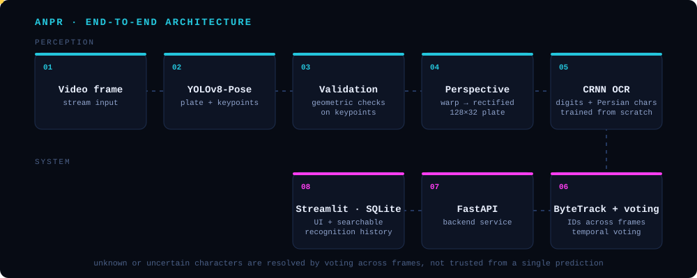
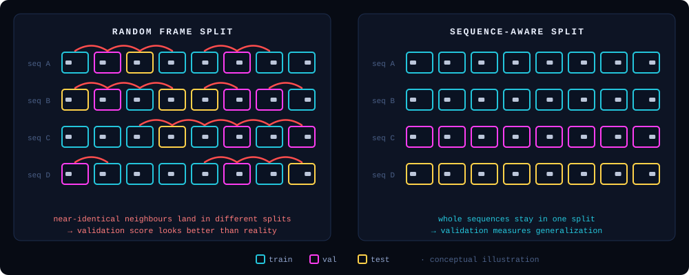
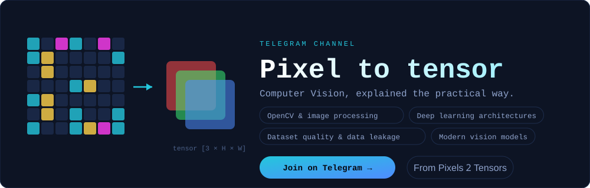

<div align="center">




</div>

<br/>

```text
$ whoami --profile

name        Mahdi Mashayekhi
role        Computer Vision Engineer
focus       detection · keypoints · OCR · tracking · geometry · data quality
based in    Tehran, Iran
speaks      Persian · English
writes      "Pixel to tensor" — Computer Vision explained for an Iranian technical audience
exploring   ConvNeXt · Vision Transformers · industrial defect detection
status      🟢 open to Computer Vision opportunities and collaboration
```

## How I think about Computer Vision

I care less about a single impressive number and more about whether a system can be trusted. Each of these ideas shows up in something I built:

| Belief | Where it shows up |
|---|---|
| **Data quality matters as much as the architecture** | In *Traffic Intelligence System* I build dataset auditing tools (validation, class remapping, duplicate and leakage checks) before any YOLO training starts. |
| **High accuracy is not the same as reliability** | In *ANPR* a single-frame OCR result is never trusted. Keypoints are validated geometrically and uncertain characters are resolved by voting across frames. |
| **Systems beat isolated notebooks** | *ANPR* runs end to end: detection → rectification → OCR → tracking → API → UI → database. |
| **Understand the decisions behind the tools** | The OCR model is trained from scratch, and projects use `pytest`, `Ruff`, `pre-commit` and `uv` for reproducible, maintainable code. |

## Projects

Three projects, one question: **what is happening on the road?** Who the vehicle is, what is in the scene, and how fast things move.

### 01 · Automatic Number Plate Recognition &nbsp;`completed`

An end-to-end license plate recognition system for video streams, built from detection to a searchable history database.

<div align="center">

</div>

**Engineering problems this project taught me**

- **Plates are rarely frontal.** YOLOv8-Pose finds the plate and its keypoints, geometric validation filters bad detections, and a perspective transform rectifies every plate to a consistent 128×32 input.
- **Off-the-shelf OCR did not fit.** I trained a CRNN from scratch on a custom character set of digits and Persian letters.
- **Video is noisy.** ByteTrack keeps identities across frames, and temporal voting handles uncertain or unknown characters.
- **A model is not a product.** FastAPI serves the pipeline, Streamlit provides the interface, and SQLite stores and searches recognition history.

`Ultralytics YOLO` `PyTorch` `OpenCV` `FastAPI` `Streamlit` `SQLite`

**[→ View repository](https://github.com/MahdiMashayekhi-AI/Automatic-Number-Plate-Recognition)**

---

### 02 · Traffic Intelligence System &nbsp;`in development`

Traffic scene analysis and object detection. Before training anything, I am building reusable tooling to make the **UA-DETRAC** dataset trustworthy instead of just downloading it and hitting train.

<div align="center">

</div>

**What the data pipeline covers**

- Dataset structure validation, annotation parsing and validation
- Class remapping and dataset statistics
- Duplicate and near-duplicate image detection
- Leakage prevention, so validation scores mean something
- YOLO-ready datasets, audited with FiftyOne

`Python` `PyTorch` `YOLO` `NumPy` `Pandas` `FiftyOne` `uv` `pytest` `Ruff`

**[→ View repository](https://github.com/MahdiMashayekhi-AI/Traffic-Intelligence-System)**

---

### 03 · Spatial Speed Estimation

Turning pixels into meters per second. Instead of guessing speed from how far something moves on screen, this project estimates vehicle speed from the geometry of the scene.

<div align="center">

</div>

**The ideas behind it**

- **A pixel is not a meter.** Camera calibration and perspective geometry map image coordinates onto real-world positions.
- **Perspective lies about motion.** The same vehicle covers far more pixels near the camera than far away, so speed has to be measured in world coordinates, not in image space.
- **Speed is motion over time.** Motion analysis across frames turns mapped positions into a speed estimate.

`Python` `OpenCV`

**[→ View repository](https://github.com/MahdiMashayekhi-AI/Spatial-Speed-Estimation)**

## Skills

| | |
|---|---|
| **Vision & Deep Learning** |      |
| **Data** |    |
| **Backend & Apps** |    |
| **Engineering** |       |
| **Exploring** |     |

## Where I'm heading

**Industrial Computer Vision**: PCB defect detection, manufacturing inspection and anomaly detection. That is where data quality, evaluation and failure-case analysis matter most, and where I want to take these skills next.

## Pixel to tensor

<div align="center">

[](https://t.me/pixel2tensor)

</div>

Practical explanations of Computer Vision and AI, written for the Iranian tech community. No motivational filler: OpenCV, architectures, dataset pitfalls and modern vision models, explained so you can actually use them.

<details>
<summary><b>🎲 Debugging log (click)</b></summary>

- 90% of "model bugs" are label bugs.
- 9% are preprocessing bugs (RGB vs BGR, I'm looking at you).
- The remaining 1% is actually the model.

</details>

## Activity

<div align="center">


<br/><br/>

<picture>
  <source media="(prefers-color-scheme: dark)" srcset="https://raw.githubusercontent.com/MahdiMashayekhi-AI/MahdiMashayekhi-AI/output/github-snake-dark.svg" />
  <source media="(prefers-color-scheme: light)" srcset="https://raw.githubusercontent.com/MahdiMashayekhi-AI/MahdiMashayekhi-AI/output/github-snake.svg" />
  
</picture>

</div>

## Contact

```text
$ ./contact --open
> Got a Computer Vision problem, a dataset that needs auditing, or an idea worth building? Let's talk.
```

<div align="center">

[](https://www.linkedin.com/in/mahdimashayekhi/)
[](mailto:mahdimashayekhi.ai@gmail.com)
[](https://mahdimashayekhi-ai.github.io/)
[](https://t.me/YOUR_CHANNEL)

<br/>

```text
░▒▓█  From pixels to perception.  █▓▒░
```

```python
while not extraordinary: build(); fail(); debug(); retrain()  # the loss only drops if you keep training.
```

</div>
