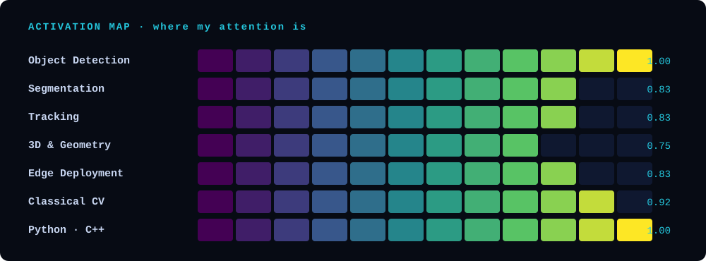

<div align="center">


</div>

<br/>

```text
$ python see.py --who me

[INFO] loading model .................. done
[INFO] input   : profile.jpg  (3, H, W)
[INFO] output  : 1 object

  class       : Computer Vision Engineer
  name        : Mahdi Mashayekhi
  based in    : Tehran, Iran
  speaks      : Persian · English
  obsessed w/ : latency, edge cases, and clean masks
  status      : 🟢 open to interesting problems

[DONE] 12.3 ms  ·  confidence 0.99
```

## 👁️ Manifesto

> **Pixels are not data. Pixels are evidence.**
> My job is to turn raw light into decisions a machine can trust.

- **See clearly first.** Great perception starts with great data, calibration and geometry, long before any model.
- **Measure everything.** If it isn't benchmarked on real hardware, it isn't fast.
- **Ship it.** A model that never leaves the notebook has not seen the world yet.

## 🎞️ The Pipeline

Every problem I solve passes through some version of this chain: from a raw frame to something a system can act on.

<div align="center">

</div>

## 🧮 Convolution, as a personality

Slide a small window across the world, keep only what matters, discard the rest. This is the primitive behind every CNN, and honestly, my approach to engineering.

<div align="center">

</div>

## 🔥 Activation Map

Where my attention fires the hardest.

<div align="center">

</div>

<div align="center">


</div>

## 🎯 Detections (Featured Projects)

| # | Project | What it sees | Stack | Conf. |
|:-:|---|---|---|:-:|
| 01 | [**Traffic Intelligence System**](https://github.com/MahdiMashayekhi-AI/Traffic-Intelligence-System) | Real-time analyze of traffic  | `PyTorch` `TensorRT` | **0.99** |
| 02 | [**Automatic-Number-Plate-Recognition**](https://github.com/MahdiMashayekhi-AI/Automatic-Number-Plate-Recognition) | Multi-object tracking with re-identification | `OpenCV` `ONNX` | **0.97** |
| 03 | [**Spatial-Speed-Estimation**](https://github.com/MahdiMashayekhi-AI/Spatial-Speed-Estimation) | Camera calibration and speed stimation | `Python` `OpenCV` | **0.95** |

## 🧬 Training History

```text
 general ML ───────────▶ deep learning ───────────▶ computer vision
 (the foundation)         (found the signal)          (full focus, no going back)
```

I started in general machine learning, which taught me how models learn. Then I found the one field where you can *see* the result of your work, and I haven't looked away since.

## 🌌 Currently

```yaml
building   : Traffic Intelligence System
exploring  : Vision Transformers · foundation models for vision · real-time 3D
optimizing : latency (every millisecond counts)
reading    : NOT RIGHT NOW
```

<details>
<summary><b>🎲 Debugging log (click)</b></summary>

- 90% of "model bugs" are label bugs.
- 9% are preprocessing bugs (RGB vs BGR, I'm looking at you).
- The remaining 1% is actually the model.

</details>

## 📊 Stats

<div align="center">


## 🤝 Let's connect

Got a camera and a problem? Let's talk.

<div align="center">

[](https://www.linkedin.com/in/mahdimashayekhi/)
[](mailto:mahdimashayekhi.ai@gmail.com)
[](https://mahdimashayekhi-ai.github.io/)

<br/>

```text
░▒▓█  The world is full of pixels. I help machines understand them.  █▓▒░
```

</div>
